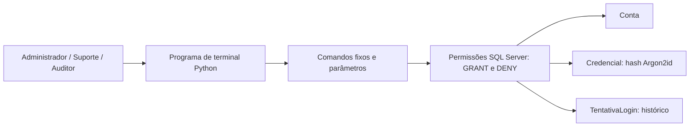

# LoginGuard — gestão de contas e acessos

**Grupo:** LoginGuard.  
**Componentes:** PREENCHER nome completo e matrícula de cada integrante.  
**Disciplina:** Segurança e Otimização de Banco de Dados.  
**Repositório:** https://github.com/Guztaver/loginguard-bd (privado; requer acesso para avaliação).

## 1. Problema e escopo
O projeto atende uma equipe de suporte que precisa cadastrar contas, controlar bloqueios e investigar acessos. Quando funcionar, o administrador poderá gerenciar as contas, o suporte acompanhará sua situação e o auditor consultará os eventos sem modificar o histórico.

O produto será um programa de terminal em Python com SQL Server. A proposta é gerenciar contas de usuários do sistema; não criar ou administrar logins de servidor SQL Server. A autenticação das contas finais e as identidades de conexão ao banco são camadas diferentes. Os papéis do banco controlam os operadores e o futuro serviço de autenticação.

O MVP terá cadastro, autenticação, bloqueio/desbloqueio e consultas de histórico. Recuperação por e-mail, MFA, aplicativos móveis e interface gráfica ficam fora das três semanas. Não são exigidos LLM, RAG, n8n ou experimento de fine-tuning para quem cursa somente BD.

## 2. Arquitetura e modelo

Relacionamentos: `Conta (1) — (0..1) Credencial` e `Conta (1) — (0..N) TentativaLogin`. Tentativas sem conta correspondente usam `ContaId = NULL`. Não se deve gravar a senha nem a entrada bruta de login no histórico.

O diagrama representa o projeto planejado. Os scripts entregam as tabelas, os três papéis humanos e dados de laboratório. O terminal, a verificação de senha e as rotinas restritas para gravar tentativas serão construídos na segunda semana. O serviço de autenticação precisará de uma identidade própria com acesso estritamente necessário; não deve usar `db_owner` nem as credenciais do administrador de implantação. A aplicação não poderá conceder um papel mais privilegiado com base apenas em um nome de perfil recebido do usuário.

## 3. Classificação de todos os campos
Não há campos públicos neste modelo: até os metadados pertencem ao sistema interno.

| Tabela | Campo | Classe | Proteção prevista |
|---|---|---|---|
| Conta | ContaId | Interno | Acesso por papel; identificador não concede autorização |
| Conta | Nome | Interno | Dados fictícios e leitura limitada aos operadores |
| Conta | Email | Sensível | Mascaramento dinâmico; sem UNMASK nos papéis humanos |
| Conta | Bloqueado | Interno | Alteração somente pelo administrador |
| Conta | CriadoEm | Interno | Leitura por papel |
| Credencial | ContaId | Interno | Tabela separada e acesso restrito |
| Credencial | HashSenha | Sensível | Hash Argon2id com salt gerado pela biblioteca; DENY SELECT para os três papéis humanos |
| Credencial | AtualizadoEm | Interno | Restrito junto à tabela de credenciais |
| TentativaLogin | TentativaId | Interno | Histórico com acesso por papel |
| TentativaLogin | ContaId | Interno | Identificador, sem copiar nome/e-mail para o histórico |
| TentativaLogin | OcorridoEm | Interno | Histórico somente leitura para operadores |
| TentativaLogin | Sucesso | Interno | Histórico somente leitura para operadores |
| TentativaLogin | IpOrigem | Sensível | Mascaramento dinâmico; excluído da view de auditoria |

A carga usa nomes `Pessoa Fictícia N`, endereços `@example.invalid` e IPs da faixa de documentação `192.0.2.0/24`. Todos os dados são sintéticos. O hash inicial é NULL e todas as contas estão bloqueadas; a autenticação deve recusar uma conta sem hash válido.

Senhas serão transformadas em Argon2id na aplicação, usando biblioteca apropriada; o valor codificado inclui salt e parâmetros. Hash não é criptografia reversível. O mascaramento reduz a exposição em consultas, mas não substitui o controle de acesso e não impede todas as inferências. Em implantação futura, a conexão deverá usar TLS com certificado validado.

## 4. Matriz de papéis do banco
| Operação | Administrador | Suporte | Auditor |
|---|---|---|---|
| Consultar contas pela view, e-mail mascarado | Sim | Sim | Sim |
| Inserir contas e alterar nome, e-mail e bloqueio | Sim | Não | Não |
| Inserir/atualizar hash para cadastro e redefinição | Sim, por componente confiável que gera o hash | Não | Não |
| Consultar hashes | DENY | DENY | DENY |
| Consultar histórico sem IP pela view | Sim | Não | Sim |
| Inserir, alterar ou excluir histórico diretamente | DENY | DENY | DENY |
| Alterar papéis ou estrutura do banco | Não concedido | Não concedido | Não concedido |

Os usuários `demo_admin`, `demo_suporte` e `demo_auditor` são identidades de teste `WITHOUT LOGIN`, associadas a um papel cada. Os testes usam `EXECUTE AS USER`. Em uma implantação, criar identidades reais separadas e mapear os papéis; os usuários de teste não autenticam pelo terminal.

O administrador funcional também recebe `DENY SELECT` em Credencial. Ele pode substituir hashes, mas não consultar seu conteúdo. O DBA que instala o banco é uma função de infraestrutura, externa à matriz: `sysadmin` e donos dos objetos não ficam limitados por esses DENYs. Não atribuir essas funções privilegiadas aos operadores.

## 5. Ameaça e prova de segurança
**Ameaça principal:** escalonamento de privilégio, por exemplo o suporte tentando desbloquear contas, ler hashes ou se adicionar ao papel de administrador.

O script 03 comprova negações para leitura de credenciais, UPDATE de conta por suporte, mudança de papel e DELETE de histórico pelo auditor, além de verificar que o e-mail aparece mascarado. Critério: todas as ações proibidas retornam erro de permissão e as consultas permitidas funcionam. Guardar saída e capturas com o nome do usuário de teste.

**Teste adicional planejado:** quando o terminal existir, fornecer `' OR 1=1 --` como identificador de login; a entrada deve ser tratada como valor e nunca liberar acesso. Todos os comandos da aplicação usarão parâmetros do driver, sem concatenar entrada do usuário ao SQL. Esse teste ainda não foi executado.

O MVP deverá registrar autenticações bem-sucedidas e falhas. As operações de escrita do serviço serão expostas por rotinas restritas; conceder INSERT ao operador de auditoria não é necessário. Um bloqueio temporário por tentativas repetidas pode ser acrescentado se houver tempo; o bloqueio administrativo faz parte do MVP.

## 6. Duas consultas e plano de otimização
| Consulta | Uso | Índice proposto |
|---|---|---|
| 1. Últimas 50 tentativas de uma conta em um período | Investigar acesso de uma conta | `(ContaId, OcorridoEm DESC) INCLUDE (Sucesso)` |
| 2. Dez contas com mais falhas em um período | Investigar concentração de falhas | Índice filtrado `(OcorridoEm, ContaId) WHERE Sucesso = 0` |

Usar 50 contas, 500 eventos iniciais e mais 200 mil eventos sintéticos gerados pelo script 04. O volume pode ser ajustado na variável do script. As consultas são candidatas a gargalo; o experimento determinará se são lentas nesse equipamento.

Executar o script 04 antes dos índices, capturar `SET STATISTICS IO, TIME ON` e habilitar plano de execução real no SSMS. Aplicar o script 05 e repetir somente o bloco das consultas, com os mesmos parâmetros e volume. Fazer uma execução de aquecimento e cinco medições de cada fase; comparar mediana de tempo, leituras lógicas e plano. Não limpar cache global de uma instância compartilhada. A criação dos índices atualiza suas estatísticas e pode alterar o aquecimento do cache.

Meta de investigação: reduzir leituras lógicas das consultas sem mudar o resultado. Registrar também duração da carga antes/depois, pois índices têm custo de escrita e armazenamento. Não afirmar ganho percentual sem medi-lo.

| Evidência | Antes | Depois |
|---|---|---|
| Q1: leituras / mediana ms / plano | A medir | A medir |
| Q2: leituras / mediana ms / plano | A medir | A medir |
| Linhas em cada tabela | A registrar | A registrar |
| Testes de permissão | A executar | A registrar |

## 7. Cronograma e pendências reais
**Semana 1:** executar criação/carga, validar os três papéis e registrar o modelo. **Semana 2:** implementar terminal, Argon2id e acesso parametrizado, com gravação restrita de tentativas. **Semana 3:** executar ataques de teste, medir consultas e consolidar documentação.

Na preparação inicial, o SQL Express foi encontrado parado e o Windows negou seu início. Portanto, os scripts ainda não foram validados em execução, a base não está comprovadamente carregada e a tabela de evidências permanece pendente. Para cumprir a entrega inicial, executar em uma instância de laboratório autorizada e anexar a saída. Preencher identificação e garantir acesso do professor ao repositório privado antes do envio individual. O prazo informado na atividade foi 27/10.

## Referências técnicas
- [Microsoft — DENY](https://learn.microsoft.com/en-us/sql/t-sql/statements/deny-transact-sql): regras e exceções de permissões.
- [Microsoft — Dynamic Data Masking](https://learn.microsoft.com/en-us/sql/relational-databases/security/dynamic-data-masking): funcionamento e limitações do mascaramento.
- [OWASP — Password Storage](https://cheatsheetseries.owasp.org/cheatsheets/Password_Storage_Cheat_Sheet.html): armazenamento de senhas com hash adaptativo.
- [OWASP — SQL Injection Prevention](https://cheatsheetseries.owasp.org/cheatsheets/SQL_Injection_Prevention_Cheat_Sheet.html): consultas parametrizadas e menor privilégio.
